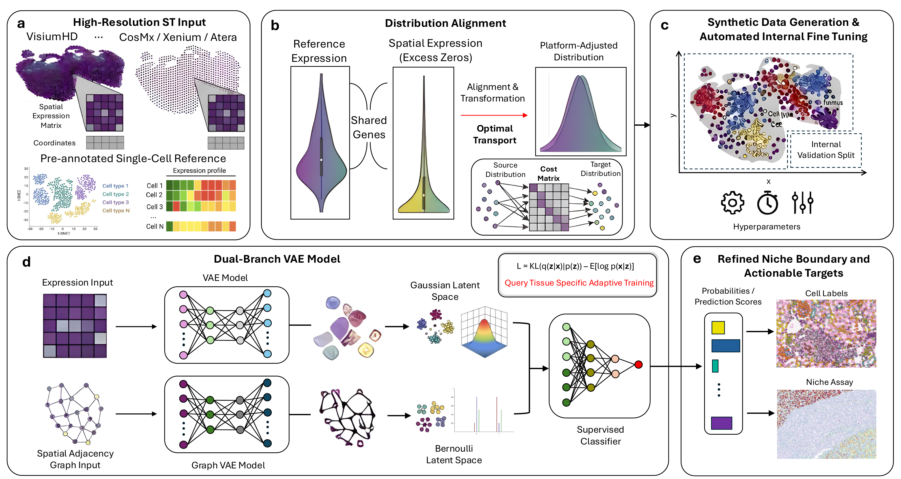

# BiNVaST: query-adaptive annotation for high-resolution spatial transcriptomics

BiNVaST is a spatially informed deep-learning framework for transferring cell-type information from a pre-annotated single-cell reference to high-resolution spatial transcriptomics data. It aligns reference and query expression distributions, generates query-matched synthetic training cells, and combines expression and spatial-graph representations in a dual-branch variational autoencoder with supervised classification.

The Python implementation is distributed as the installable `binvast` package. The repository also includes an R preprocessing workflow for shared-gene selection and generation of the standardized inputs consumed by the package. The full datasets are not included, but small sparse spatial and single-cell reference bundles are provided for the worked example.

## Model overview



The original vector-quality overview is available as [Figure1.pdf](images/Figure1.pdf).

The workflow consists of four stages:

1. Select shared variable genes and export aligned query/reference matrices in R.
2. Align the reference distribution to the query and generate query-matched synthetic cells.
3. Train expression and spatial-graph VAE branches with an internal validation split.
4. Predict query-cell labels and probability scores using the trained model.

## Repository structure

```text
BiNVaST/
├── src/binvast/
│   ├── __init__.py        # Public package interface
│   ├── synthetic.py       # Distribution alignment and synthetic-data generation
│   ├── model.py           # BinVAST architecture, training, and prediction functions
│   ├── pipeline.py        # Full training and snapshot pipeline
│   ├── workflow.py        # High-level train_and_predict workflow
│   └── cli.py             # Additional command-line entry points
├── R/
│   └── select_shared_vst_seurat.R
├── examples/
│   ├── basic_workflow.py
│   └── xenium_10x_guide/
│       ├── xenium_ovarian_10x_binvast.ipynb
│       ├── prepare_10x_guide_data.R
│       ├── make_toy_10x_data.R
│       └── toy_data/
│           ├── toy_spatial.rds
│           └── toy_single_cell_reference.rds
├── images/
├── pyproject.toml
├── setup.cfg
└── README.md
```

## Installation

Python 3.9 or later is required. A virtual environment is recommended.

### Install directly from GitHub

```bash
python -m venv .venv
source .venv/bin/activate
python -m pip install --upgrade pip
python -m pip install "git+https://github.com/zhangjx1996/BiNVaST.git"
```

### Install from a local clone

```bash
git clone https://github.com/zhangjx1996/BiNVaST.git
cd BiNVaST
python -m venv .venv
source .venv/bin/activate
python -m pip install --upgrade pip
python -m pip install .
```

For development, use an editable installation:

```bash
python -m pip install -e .
```

BiNVaST uses PyTorch. For GPU training, install the PyTorch build appropriate for the CUDA version on the compute system before installing BiNVaST. See the [official PyTorch installation selector](https://pytorch.org/get-started/locally/).

Verify the installation:

```bash
python -c "import binvast; print(binvast.__version__)"
```

## Executed 10x Xenium example

The [10x Xenium ovarian-cancer notebook](examples/xenium_10x_guide/xenium_ovarian_10x_binvast.ipynb)
downloads the public query and matched scRNA-seq reference used in the 10x
Genomics annotation guide, reproduces its 100,000-cell Seurat sketch, runs the
BiNVaST workflow, and displays the predicted labels in tissue space. The
checked-in outputs use a 50-epoch checkpoint on all 100,000 sketch cells; add
later epoch snapshots for a longer analysis.

For an upload-friendly test, use the two tracked sparse RDS files in
`examples/xenium_10x_guide/toy_data/`. Together they are under 3 MiB and contain
5,000 spatial cells plus a balanced 1,200-cell reference covering all 16 labels.
The example R script detects these bundles automatically and produces the same
standardized four-file input interface used by the Python package.

## Prepare input data in R

The R workflow selects shared variable genes from the raw query data and a pre-annotated single-cell reference. It then exports aligned expression matrices, query spatial coordinates, and reference labels for the Python package.

Edit the `RSTUDIO_SETTINGS` block in `R/select_shared_vst_seurat.R`, keep `RUN_R_STUDIO_WORKFLOW <- FALSE` while checking the paths, then change it to `TRUE` and source the script in RStudio.

Required R packages:

```r
install.packages(c("Seurat", "Matrix", "data.table"))
```

The R workflow creates the following core input bundle:

```text
target_expression_log1p_cp10k.csv
target_coordinates.csv
reference_expression_log1p_cp10k.csv
reference_labels.csv
```

All expression matrices are cells by genes with `cell_id` in the first column. Query and reference matrices must contain the same selected genes in the same order.

| File | Required content |
| --- | --- |
| `target_expression_log1p_cp10k.csv` | `cell_id`, followed by selected genes |
| `target_coordinates.csv` | `cell_id`, `x`, `y` |
| `reference_expression_log1p_cp10k.csv` | `cell_id`, followed by the same selected genes |
| `reference_labels.csv` | `cell_id`, `label` |

## Use BiNVaST as a Python package

### 1. Generate query-matched synthetic data

```python
from binvast import generate_synthetic_data

synthetic_result = generate_synthetic_data(
    input_data_dir="/path/to/preprocessed_input",
    output_dir="/path/to/synthetic_input",
    pca_base="reference",
    n_pcs=50,
    tau=1.0,
    seed=259,
)

print(synthetic_result["files"])
```

The function writes:

```text
synthetic_expression.csv
synthetic_labels.csv
synthetic_spatial_coords.csv
synthetic_cell_type_counts.csv
```

The default strategy fits PCA to the globally aligned reference. Set `pca_base="target"` to fit PCA to the query and project the aligned reference into query PCA space. Both modes use nearest-reference-cell distances within each cell type, Gaussian-kernel label sampling, and dropout-only zero alignment.

### 2. Train the model and annotate the real query data

```python
from binvast import train_and_predict

result = train_and_predict(
    project_dir="/path/to/binvast_project",
    target_data_dir="/path/to/preprocessed_input",
    synthetic_data_dir="/path/to/synthetic_input",
    output_dir="/path/to/binvast_output",
    snapshot_epochs=[50, 100, 150, 200],
    batch_size=512,
    graph_k=30,
    expr_latent_dim=4,
    graph_latent_dim=4,
    seed=259,
)

final_labels = result["manifest"]["final_predicted_labels"]
print(final_labels)
```

Training follows one continuous trajectory to the largest requested epoch and saves exact model, latent, prediction, and summary snapshots at each requested epoch. The final per-cell annotation table is `target_predicted_labels.csv` in the largest-epoch snapshot directory.

### 3. Predict another prepared query dataset with a saved checkpoint

```python
from binvast import predict_labels

predictions, *_ = predict_labels(
    target_count_csv="/path/to/new_query_expression.csv",
    target_coord_csv="/path/to/new_query_coordinates.csv",
    ckpt_path="/path/to/binvast_checkpoint.pt",
    output_csv="/path/to/new_query_predicted_labels.csv",
    target_input_normalized="log",
)

print(predictions.head())
```

The checkpoint stores the selected genes, expression-scaling parameters, coordinate normalization parameters, label classes, model configuration, and trained weights required for prediction.

## Command-line interface

Installing the package also installs three commands.

Generate synthetic data:

```bash
binvast-simulate \
  --input-data-dir /path/to/preprocessed_input \
  --output-dir /path/to/synthetic_input \
  --pca-base reference \
  --n-pcs 50 \
  --tau 1.0 \
  --seed 259
```

Train and annotate the query data:

```bash
binvast-run \
  --project-dir /path/to/binvast_project \
  --target-data-dir /path/to/preprocessed_input \
  --synthetic-data-dir /path/to/synthetic_input \
  --output-dir /path/to/binvast_output \
  --snapshot-epochs 50 100 150 200 \
  --batch-size 512 \
  --graph-k 30 \
  --seed 259
```

Apply a saved checkpoint:

```bash
binvast-predict \
  --target-expression /path/to/new_query_expression.csv \
  --target-coordinates /path/to/new_query_coordinates.csv \
  --checkpoint /path/to/binvast_checkpoint.pt \
  --output-csv /path/to/new_query_predicted_labels.csv \
  --target-input-normalized log
```

## Main Python API

| Function | Purpose |
| --- | --- |
| `generate_synthetic_data()` | Align reference/query distributions and create synthetic training cells |
| `train_and_predict()` | Train continuously, save epoch snapshots, and annotate the real query data |
| `predict_labels()` | Apply a saved checkpoint to another prepared query dataset |
| `load_trained_model()` | Restore a saved BinVAST model and checkpoint metadata |
| `run_full_synthetic_binvast_epoch_grid()` | Lower-level continuous snapshot training interface |

All lower-level preprocessing, graph, model, loss, evaluation, and output functions remain importable from `binvast.synthetic`, `binvast.model`, and `binvast.pipeline`.

## Main parameters

### Synthetic-data generation

| Parameter | Description | Default |
| --- | --- | --- |
| `pca_base` | Dataset used to fit PCA: `reference` or `target` | `reference` |
| `n_pcs` | Number of principal components | `50` |
| `tau` | Gaussian-kernel temperature for label sampling | `1.0` |
| `seed` | Random seed | `259` |
| `csv_chunk_size` | Rows processed per CSV chunk | `2000` |
| `assignment_batch_size` | Query cells processed per assignment batch | `10000` |

### Model training

| Parameter | Description | Default |
| --- | --- | --- |
| `snapshot_epochs` | Epochs at which exact outputs are saved | `50, 100, 150, 200` |
| `batch_size` | Training batch size | `512` |
| `graph_k` | Spatial nearest neighbors used to construct the graph | `30` |
| `expr_latent_dim` | Expression VAE latent dimension | `4` |
| `graph_latent_dim` | Graph VAE latent dimension | `4` |
| `seed` | Random seed | `259` |

Additional architecture and loss settings are defined by `binvast.model.TrainConfig`.

## Output

Each epoch/batch-size snapshot is written to a directory such as:

```text
epochs_050_batch_00512/
epochs_100_batch_00512/
```

Outputs include trained checkpoints, preprocessing metadata, latent representations, per-cell prediction scores, predicted labels, cell-type counts, and percentages. Important summary files include:

```text
target_predicted_labels.csv
target_predicted_label_counts_with_legend_percent.csv
target_cell_type_proportions_by_epoch_and_batch.csv
binvast_workflow_manifest.json
```

## Reproducibility

The workflow exposes a random seed for synthetic-label sampling, PCA, validation splitting, model initialization, and training. Exact GPU results can still depend on the PyTorch/CUDA versions and hardware.

## Citation

If you use BiNVaST in your research, please cite the associated manuscript. Citation details will be added when the manuscript is available.

## License

No license has been assigned yet. Add a license before public release if reuse and redistribution should be permitted.
